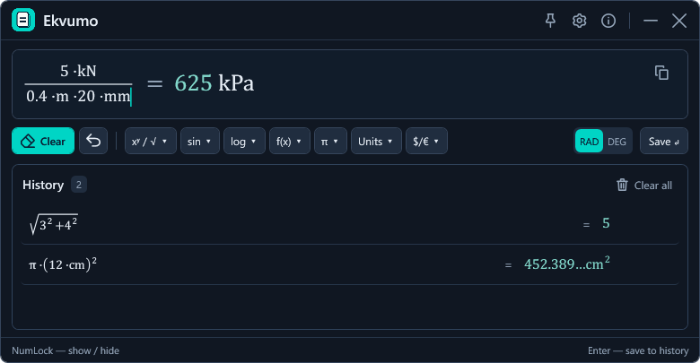

# Ekvumo Calculator

**English** · [Русский](README.ru.md)

**An engineering calculator for Windows with calculation history.** Open it with `NumLock`, enter formulas in standard mathematical notation, and calculate with units.

[**Download for Windows**](https://github.com/Tama-gon/Ekvumo-Calculator-Releases/releases)

## Features

- **Open with `NumLock`.** Press once to show or hide the calculator. Num Lock stays on. You can assign a different shortcut.
- **Formula editor.** Enter and edit fractions, powers, and roots in standard mathematical notation.
- **Calculations with units.** Enter `5*kN/(0.4*m*20*mm)` to get `625 kPa`.
- **Currencies as units.** Convert amounts and prices per unit at current exchange rates, for example from `USD/m²` to `EUR/m²`.
- **Minimalist interface.** A compact layout keeps the formula, result, and history in view.
- **Autocomplete suggestions.** As you type, a pop-up list suggests functions, constants, and units.

## Installation

Download `Ekvumo.Calculator-beta-Setup.exe` from the release’s Assets section and run it. Requires Windows 11 x64. The installer includes .NET. [SourceCraft mirror](https://grand-storm.sourcecraft.site/ekvumo-calculator/)

The interface is available in English and Russian.
