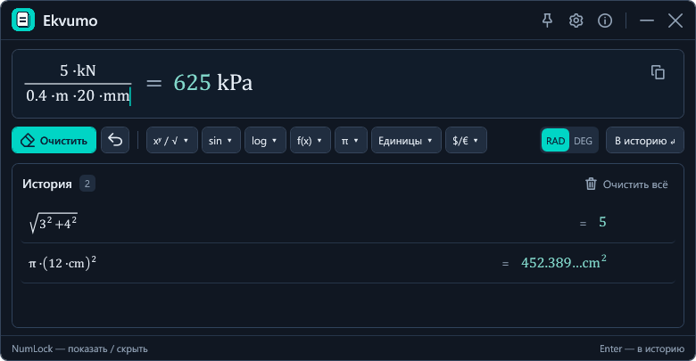

# Ekvumo Calculator

[English](README.md) · **Русский**

**Инженерный калькулятор для Windows с историей расчётов.** Открывается по `NumLock`, показывает формулы в привычном виде и считает с единицами измерения.

[**Скачать для Windows**](https://github.com/Tama-gon/Ekvumo-Calculator-Releases/releases)

## Возможности

- **Вызов по `NumLock`.** Одно нажатие показывает или скрывает калькулятор. `NumLock` при этом всегда остаётся включённым. Можно назначить другую клавишу вызова.
- **Ввод выражений в формульной, а не строчной нотации.** Редактируйте дроби, степени и корни так, как они должны выглядеть.
- **Расчёты с единицами измерения.** Введите `5*kN/(0.4*m*20*mm)` и получите `625 kPa`.
- **Валюта как единица измерения.** Пересчитывайте суммы и цены за единицу по актуальному курсу, например из `USD/m²` в `EUR/m²`.
- **Минималистичный интерфейс.** Только важное — без лишних кнопок.
- **Всплывающее автодополнение.** При вводе редактор предлагает функции, константы и единицы измерения.

## Установка

Скачайте `Ekvumo.Calculator-beta-Setup.exe` из файлов выпуска и запустите его. Требуется Windows 11 x64. Среда .NET уже включена в установщик. [Зеркало SourceCraft](https://grand-storm.sourcecraft.site/ekvumo-calculator/)

Интерфейс доступен на русском и английском.
